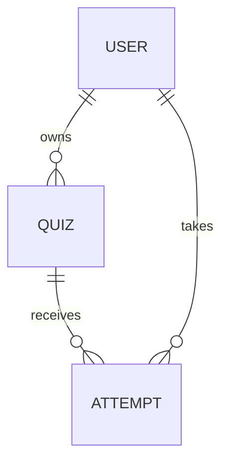

# Shared API contract: quizzes and participant attempts

This contract describes the API implemented by the sibling `quizzo_backend` and consumed by the frontend. All quiz/attempt endpoints below require a bearer token because participants must sign in. Signup and sign-in are public. See the [backend guide](../../quizzo_backend/documentation/overview.md) and [verification status](../../quizzo_backend/documentation/verification.md).

## What the shared link contains

A shareable link is an ordinary frontend URL:

```text
https://your-app.example/q/h8Kx2mP9sL4v
                            └── opaque shareId
```

The link contains an identifier. It does not contain the quiz object, correct answers, participant identity, score, JWT, or a socket connection. The server resolves the identifier to the published quiz. The frontend constructs the URL using its own origin and the server-returned `shareId`.

Everyone opening that link sees the same published quiz version. Starting the quiz creates a different **Attempt** for each participant (and for each retake). One person's answers never modify another person's attempt or the underlying quiz.

Self-paced quizzes are naturally handled over HTTP. If live owner updates are wanted later, Socket.IO can notify an authenticated owner room that a completed attempt is available, and the owner can refetch results. Do not use a transient socket ID as the durable quiz/share identifier.

## Stored records



**Quiz / published version**

```js
{
  id, owner, title, description,
  shareId, version: 1, publishedAt,
  questions: [{ id, text, options, correctOption }],
  createdAt, updatedAt
}
```

The server generates a 24-character cryptographically random, URL-safe `shareId` with a unique index. Publishing returns this identifier. MongoDB stores `_id`; HTTP serializers return `id` strings.

Treat published question content as immutable for a version. Future edits should create another version, and each attempt must reference the version it started. Otherwise, editing the answer key can change the meaning of an existing score. The present UI edits drafts only.

**Attempt**

```js
{
  id, quizId, quizVersion, userId,
  participantName, // snapshot from authenticated profile
  status: "in_progress" | "submitted",
  answers: [{ questionId, optionIndex }],
  result: { score, totalQuestions, percentage }, // only after submission
  snapshot: [{ id, text, options, correctOption }], // private server-side copy
  quizTitle, shareId,
  startedAt, completedAt,
  startRequestId
}
```

Store attempts in their own collection instead of growing an unbounded participant array inside the quiz document. Use indexed `quizId` and `userId` references; the owner dashboard queries attempts for a quiz after verifying ownership. The participant's name should come from the authenticated account, not a trusted request-body name.

Retakes are currently allowed: each new start has another attempt ID. The owner table shows completed attempts and computes the unique participant count using `userId`.

## Authorization and grading

- Require a valid user for every protected endpoint and always finish failed requests with a JSON error.
- Only the quiz owner may retrieve owner quiz details, the answer key, or all participant results.
- Only the participant who owns an attempt may fetch/submit that attempt. Owner results use the separate owner endpoint.
- Participant responses must never include `correctOption` or another answer-key field.
- Accept question IDs and selected indexes; calculate the score against the stored quiz version on the server. Ignore/reject submitted scores.
- Validate that all expected question IDs appear exactly once, indexes are valid, and no foreign question is included.
- Submission must atomically finalize an attempt once. Retrying a completed submission returns its existing result rather than grading or inserting another record.
- The frontend sends an `Idempotency-Key` header for start and submit. Scope start keys to the authenticated user and quiz. Enforce uniqueness server-side rather than relying on disabled buttons.
- If answer persistence is later moved to the server, add a dedicated save-progress operation; the current UI keeps unfinished selections locally.

One point is awarded per correct answer, with no negative marking. `percentage = round(score / totalQuestions * 100)`.

## Shared response conventions

Use `id` strings, numeric counts/scores/percentages, ISO date strings, and JSON errors:

```json
{ "error": "A useful explanation." }
```

Return `401` for invalid authentication, `403` for disallowed ownership, `404` for unavailable records/links, `400` for invalid input, and `500` for unexpected errors. Avoid hanging requests and HTTP-200 plain-text authentication failures.

### Account changes

Signup accepts `{ name, email, password }` and returns `201 { user }`. Sign-in returns `200 { token, user }`. GET `/api/auth/me` returns:

```json
{
  "user": {
    "id": "user-id",
    "name": "Maya Kapoor",
    "email": "maya@example.com"
  }
}
```

Hash passwords and omit them from all response bodies/logs. The frontend strips unexpected user fields from its auth context, but the server must still return safe data.

### POST /api/quizzes — publish a quiz

Request stays compatible with the current title/description/questions payload. The server derives owner identity and generates question IDs.

```js
{
  message: "Quiz created successfully.",
  quiz: {
    id, title, description, shareId, ownerName,
    questionCount, createdAt,
    attemptCount: 0, averageScore: null
  }
}
```

The frontend never invents a live share ID. Legacy saved quizzes receive stable codes through owner list/detail reads. Quiz publishing is not idempotent; after an uncertain save timeout the UI directs the owner to check My quizzes before retrying.

### GET /api/quizzes — owner summaries

```js
{
  quizzes: [{
    id, title, description, shareId, ownerName,
    questionCount, createdAt, attemptCount, averageScore
  }]
}
```

Only return the current user's owned quizzes. `attemptCount` counts completed attempts; `averageScore` is their average percentage, or null when none exist.

### GET /api/quizzes/:quizId — owner detail

```js
{
  quiz: {
    id, title, description, shareId, ownerName,
    questionCount, createdAt, attemptCount, averageScore,
    questions: [{ id, text, options, correctOption }]
  }
}
```

The answer key here is permitted only because this is an owner-authorized endpoint.

### GET /api/quizzes/:quizId/attempts — owner results

```js
{
  attempts: [{
    id, userId, participantName,
    score, totalQuestions, percentage, completedAt
  }]
}
```

Return completed attempts only, newest first by default. No results means an empty array. For large deployments add pagination and adapt frontend totals/search to server-side queries.

### GET /api/shared/quizzes/:shareId — participant intro

```js
{
  quiz: {
    id, title, description, shareId, ownerName, questionCount
  }
}
```

Resolve the published quiz and return metadata only. Authentication is required even though this is a shared link.

### POST /api/shared/quizzes/:shareId/attempts — start

Body: `{}`. Header: `Idempotency-Key: <client-generated request UUID>`.

Create a new attempt or replay the response for the same user/quiz/request key. Return:

```js
{
  attempt: {
    id, quizId, quizTitle, shareId, participantName,
    status: "in_progress", totalQuestions, startedAt,
    questions: [{ id, text, options }],
    answers: []
  }
}
```

The questions contain no correct-answer index.

### GET /api/attempts/:attemptId — attempt/result read

Return the same attempt shape as start. For a completed attempt, include:

```js
{
  attempt: {
    id, quizId, quizTitle, shareId, participantName,
    status: "submitted", totalQuestions,
    startedAt, completedAt,
    questions: [{ id, text, options }],
    answers: [{ questionId, optionIndex }],
    result: { score, totalQuestions, percentage }
  }
}
```

This endpoint allows refreshing both the player and the final result page. It must verify the current user owns the attempt.

### POST /api/attempts/:attemptId/submit — finalization

Header: `Idempotency-Key: submit-<attemptId>`.

```js
{
  answers: [
    { questionId: "question-1", optionIndex: 2 },
    { questionId: "question-2", optionIndex: 0 }
  ]
}
```

Return `{ attempt }` with `status: "submitted"`, `completedAt`, and the server-generated `result` object. The frontend displays success only after receiving this confirmation, then reloads the result through the attempt-read endpoint.

## Integration and verification

Normal mode calls relative `/api` paths, proxied by Vite during development and served directly by Express in a combined deployment. `VITE_BACKEND_URL` configures that development proxy; `VITE_API_URL` is an optional separate public API origin.

The backend implements these routes, private snapshots, unique start keys, and atomic submission. Its real-MongoDB integration suite uses the actual frontend API modules and covers multiple accounts, retries, access denial, legacy migrations, and restart persistence. See [verification.md](../../quizzo_backend/documentation/verification.md) for executed checks and environment blockers. Cross-device/public links additionally require a reachable deployment.

The preview adapter in `src/api/demoStore.js` exercises the UI contract locally. Its local identity checks and browser scoring are test conveniences, not a replacement for backend authentication, authorization, or grading.
