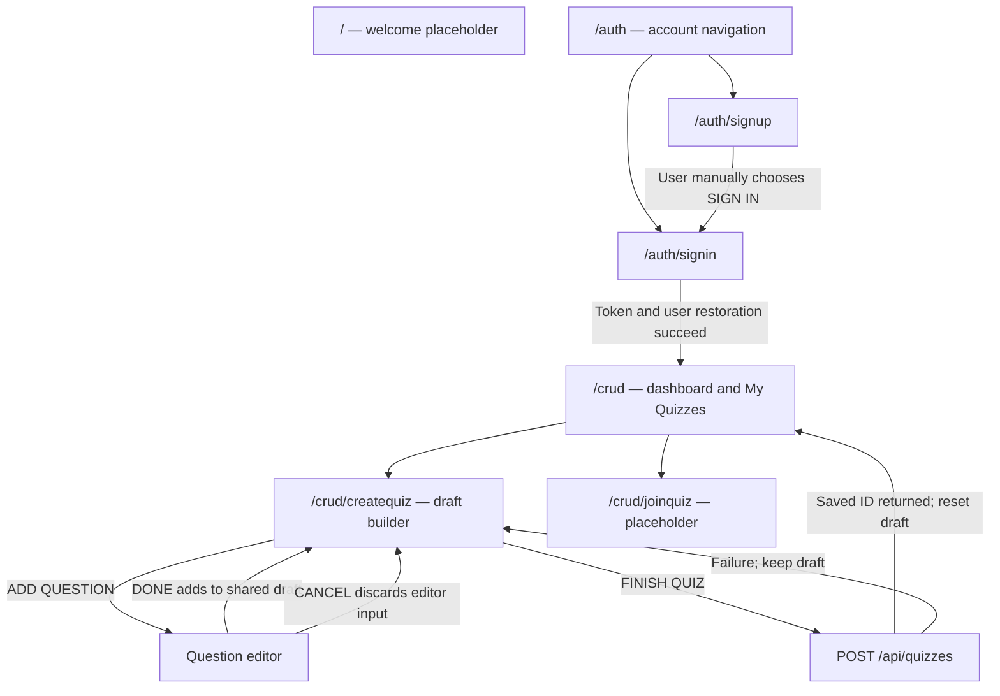
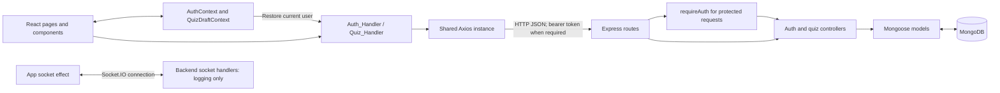
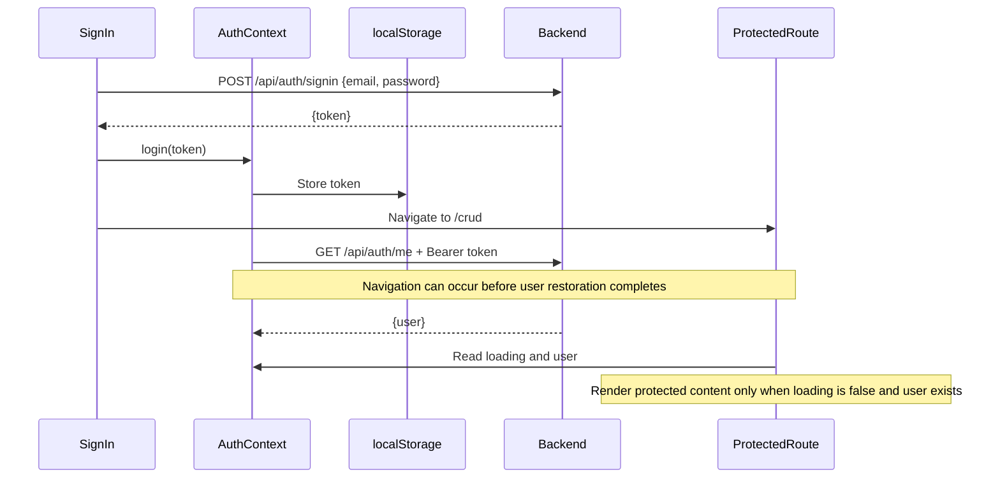

# Quizzo frontend: project overview and developer guide

This guide explains the application from a first-time user's point of view, then follows the code behind each screen and request. It describes the implementation reviewed on **25 October 2026**, including the parts that are still unfinished. UI descriptions come from the JSX and CSS; the validation notes at the end distinguish build checks from live application testing.

The folder is named `quizzo_frontend`, while the interface uses the name **QUIZLY**. Both names refer to this application.

## Contents

1. [What the project is](#1-what-the-project-is)
2. [The user workflow](#2-the-user-workflow)
3. [Routes, pages, and components](#3-routes-pages-and-components)
4. [Architecture and folder structure](#4-architecture-and-folder-structure)
5. [State and persistence](#5-state-and-persistence)
6. [Authentication from browser to database](#6-authentication-from-browser-to-database)
7. [Building and saving a quiz](#7-building-and-saving-a-quiz)
8. [HTTP API contracts](#8-http-api-contracts)
9. [Backend structure and stored data](#9-backend-structure-and-stored-data)
10. [Socket.IO and the join flow](#10-socketio-and-the-join-flow)
11. [Visual design and responsive behavior](#11-visual-design-and-responsive-behavior)
12. [Local setup and project commands](#12-local-setup-and-project-commands)
13. [Current limitations and implementation details](#13-current-limitations-and-implementation-details)
14. [Where to start reading or making changes](#14-where-to-start-reading-or-making-changes)
15. [Verification of this overview](#15-verification-of-this-overview)

## 1. What the project is

Quizzo is a browser application for creating multiple-choice quizzes. A user creates an account, signs in, writes a quiz title and optional description, adds questions with answer choices, selects the correct answers, and saves the quiz to a backend database. Their dashboard then lists the quizzes they own.

The frontend is the part that runs in the browser: it renders screens, handles clicks and forms, remembers the current draft, and sends requests. The sibling [`quizzo_backend`](../../quizzo_backend/) folder contains the server that authenticates users, validates quiz data, and reads or writes MongoDB.

The implemented product currently concentrates on **quiz authoring and listing**. The code also contains a Join Quiz screen and a Socket.IO connection, but these do not yet provide a playable quiz session.

| Capability | Current implementation |
| --- | --- |
| Account registration | Email/password form and signup endpoint exist; success feedback and error handling are incomplete. |
| Sign-in and session restoration | JWT-based authentication, a shared auth context, and protected routes exist; there is a redirect timing issue described below. |
| Quiz drafting | Title, description, and questions are kept in shared React state. |
| Question creation | Four answer choices, one correct answer, and validation for empty or duplicate choices. |
| Draft management | Add questions, delete draft questions, and reset the draft. |
| Save a quiz | Authenticated HTTP request stores the complete quiz in MongoDB. |
| My Quizzes | Fetches the signed-in user's saved quiz summaries and shows cards. |
| Join a quiz | Placeholder page only. |
| Host/play a quiz, submit answers, score results, or show a leaderboard | No implemented end-to-end flow. |
| Open, edit, or delete an already saved quiz | No page, card action, or HTTP endpoint in the current implementation. |

Some terms used throughout this guide:

| Term | Meaning in this project |
| --- | --- |
| Component | A React function that renders a piece of the interface. A page is usually a component associated with a URL. |
| Route | The URL-to-page mapping, such as `/crud/createquiz` showing the quiz builder. |
| Context/provider | React's way of sharing values and functions with multiple components. This app uses it for authentication and the quiz draft. |
| Draft | The unfinished quiz in browser memory. It is not saved to the database yet. |
| API request | An HTTP message from the frontend to the backend, usually carrying or returning JSON. |
| JWT/token | A signed string returned by the backend after sign-in and sent with protected requests. |
| MongoDB/Mongoose | MongoDB stores the data; Mongoose defines the server-side data models and performs database operations. |
| CRUD | Create, read, update, and delete. The `/crud` name is used for the dashboard, but full CRUD for saved quizzes is not implemented. |

## 2. The user workflow

### 2.1 Enter the application

Opening `/` renders `Welcome`, which currently contains only `WELCOME PAGE`. It has no button or link into authentication. For the working account flow, open `/auth/signup` or `/auth/signin` directly.

Opening `/auth` shows the QUIZLY heading and SIGN UP / SIGN IN navigation. The selected child form appears below those links. `/auth` itself has no default child form.

### 2.2 Create an account

The signup screen has labeled email and password inputs and a SIGN UP button. The button reads the values and calls the signup API.

After a successful request, the current component only logs the result. It does not automatically sign the user in, navigate to sign-in, or show a confirmation. The user must choose the SIGN IN link manually.

### 2.3 Sign in and reach the dashboard

The sign-in form sends the email and password to the backend. When it receives a token, it stores that token through `AuthContext` and attempts to navigate to `/crud`.

The auth provider then requests the current user from `/api/auth/me`. Protected pages require that returned user object, not just the presence of a token. There is currently a timing issue: navigation can happen before the user has loaded, sending the browser back to sign-in. [Section 6](#6-authentication-from-browser-to-database) explains this behavior.

Once the user is restored, `/crud` displays a `Landing Page` heading, Create Quiz and Join Quiz buttons, and the My Quizzes section.

### 2.4 Start a quiz draft

Create Quiz opens `/crud/createquiz`. The builder contains:

- A header with a DASHBOARD button, `QUIZLY // QUIZ BUILDER`, and a DRAFT indicator.
- A configuration panel for the quiz title and optional description.
- A question counter and an empty state until questions have been added.
- An ADD QUESTION button.
- RESET DRAFT and FINISH QUIZ controls.

Typing updates the shared draft immediately. No backend request is made for title or description changes.

### 2.5 Add questions

ADD QUESTION opens `/crud/createquiz/create-question`. The editor asks for the question text and four options labeled A, B, C, and D. A radio control identifies the correct answer; A is selected initially.

Submitting the editor checks that the question is nonempty, all four options are nonempty, and the options are unique after trimming spaces and ignoring letter case. If valid, it adds the question to the shared draft and returns to the builder.

This action saves the question **to the draft in memory**. It does not call the backend. CANCEL or BACK TO QUIZ leaves without adding the unfinished question.

Back in the builder, each question appears in a numbered card. Its options are displayed, and the correct option is highlighted with a `[ CORRECT ]` label. DELETE removes that question from the draft. There is no edit-existing-question action; the current UI allows deleting and adding a replacement.

### 2.6 Finish and save

FINISH QUIZ requires a nonblank title, at least one question, and an authentication token. It submits the entire quiz in one request.

While the request runs, the finish button reads `SAVING...`, and add, delete, reset, and finish controls are disabled. A successful response must contain a saved quiz ID. Only then does the frontend clear the draft and navigate to the dashboard.

If saving fails, the builder shows an error and retains the draft. For a timeout, the message explains that the backend might already have saved the quiz, so the user should check My Quizzes before retrying.

RESET DRAFT is separate from saving. It asks for confirmation and then clears the title, description, and all draft questions.

### 2.7 View saved quizzes or visit Join Quiz

When the dashboard mounts, My Quizzes loads the current user's quiz summaries from the backend. It displays loading, error, empty, or populated states. Populated cards show a numbered index, quiz title, and question count, ordered newest first by the backend.

The cards have hover styling and a decorative arrow, but they are not clickable. There is no quiz detail view behind them.

Join Quiz opens a page containing only `join quiz page`. It does not ask for a code, join a room, display questions, or communicate with the server itself.



The standalone welcome node reflects the missing navigation from `/`. The sign-in arrow describes the successful path; the current authentication timing caveat still applies.

## 3. Routes, pages, and components

Routing is declared in [`src/logic/all_routes.jsx`](../src/logic/all_routes.jsx) using React Router's `BrowserRouter`, `Routes`, and `Route`.

| URL | Component | Access | Responsibility |
| --- | --- | --- | --- |
| `/` | [`Welcome`](../src/pages/Welcome.jsx) | Public | Welcome placeholder. |
| `/auth` | [`AuthPage`](<../src/pages/auth pages/AuthPage.jsx>) | Public | Shared QUIZLY heading, signup/sign-in links, and an `Outlet` for the chosen form. |
| `/auth/signup` | [`SignUp`](<../src/pages/auth pages/SignUp.jsx>) | Public | Reads email/password using refs and requests account creation. |
| `/auth/signin` | [`SignIn`](<../src/pages/auth pages/SignIn.jsx>) | Public | Controlled email/password form; requests a token, calls `login`, and navigates. |
| `/crud` | [`LandingPage`](../src/pages/quiz_crud_pages/LandingPage.jsx) | Protected | Dashboard actions and embedded `MyQuizzes`. |
| `/crud/createquiz` | [`CreateQuiz`](../src/pages/quiz_crud_pages/CreateQuiz.jsx) | Protected | Quiz metadata, draft question cards, reset/delete actions, and final API submission. |
| `/crud/createquiz/create-question` | [`CreateQ`](../src/pages/quiz_crud_pages/CreateQ.jsx) | Protected | One new question's temporary form and validation. |
| `/crud/joinquiz` | [`JoinQuiz`](../src/pages/quiz_crud_pages/JoinQuiz.jsx) | Protected | Join placeholder. |

The protected routes are children of a pathless `ProtectedRoute`. This component shows `Loading...` during initial auth restoration, redirects to `/auth/signin` with `replace` if there is no user, or renders an `Outlet` when access is allowed.

Although the quiz URLs share prefixes, the dashboard, builder, question editor, and join page are sibling route entries under this guard. `LandingPage` does not wrap the other quiz pages. By contrast, signup and sign-in really are nested inside the `AuthPage` layout.

Other rendered or shared components are:

| Component | Where it lives | Responsibility |
| --- | --- | --- |
| `App` | [`src/App.jsx`](../src/App.jsx) | Owns the Socket.IO connection and wraps the router in both context providers. |
| `All_routes` | [`src/logic/all_routes.jsx`](../src/logic/all_routes.jsx) | Installs browser routing and renders the global cursor effect plus the active route. |
| `ProtectedRoute` | [`src/logic/ProtectedRoute.jsx`](../src/logic/ProtectedRoute.jsx) | Reads auth state to decide whether to render protected content. |
| `AuthProvider` / `useAuth` | [`src/context/AuthContext.jsx`](../src/context/AuthContext.jsx) | Shares token, user, loading, login, and logout. |
| `QuizDraftProvider` / `useQuizDraft` | [`src/context/QuizDraftContext.jsx`](../src/context/QuizDraftContext.jsx) | Shares the unfinished quiz and functions that change it. |
| `MyQuizzes` | [`src/pages/quiz_crud_pages/MyQuizzes.jsx`](../src/pages/quiz_crud_pages/MyQuizzes.jsx) | Fetches and renders saved quiz summaries inside the dashboard; it has no standalone route. |
| `CursorFX` | [`src/CursorFX.jsx`](../src/CursorFX.jsx) | Draws and animates the decorative pointer ring, dot, and trail. |

Question cards, answer rows, headers, and buttons are currently JSX inside the page files. They are not separate reusable React components, and there is no shared `components/` directory or application-wide navbar.

There is also no wildcard/404 route, no default redirect from `/auth`, and no redirect away from public auth screens for an already signed-in user. The guard does not remember the originally requested destination.

## 4. Architecture and folder structure

### 4.1 Technology choices

| Technology | Role |
| --- | --- |
| React 19 and React DOM 19 | Components, rendering, effects, refs, and local state. |
| React Router DOM 7 | Browser URL routing, nested layouts, navigation, and route guards. |
| Vite 7 with the React plugin | Development server, React fast refresh, and production bundling. |
| Axios 1 | Shared HTTP client and API requests. |
| Socket.IO Client 4 | Persistent connection for the preliminary socket integration. |
| Plain CSS | Global terminal theme plus builder and quiz-list styles. |
| ESLint 9 | JavaScript, React Hooks, and React Refresh checks. |
| Express 5, Socket.IO 4, Mongoose 9, MongoDB | Server HTTP routes, socket events, validation, and storage in the sibling backend. |

The frontend uses JavaScript and JSX with ES modules. It does not use TypeScript, Redux, a component library, a server-state caching library, or server-side rendering. `dotenv` is listed as a frontend dependency, but browser configuration is read through Vite's `import.meta.env`.

### 4.2 Overall data flow



The frontend has no direct database connection. Pages decide when to request data; API handlers build the requests; the backend authenticates and validates them; database results return as JSON and update React state.

### 4.3 Application startup and component tree

[`index.html`](../index.html) supplies `<div id="root">` and loads [`src/main.jsx`](../src/main.jsx). `main.jsx` imports the global stylesheet, creates the React root, and renders `App` inside `StrictMode`.

```text
StrictMode
└── App                          owns Socket.IO setup/cleanup
    └── AuthProvider             token + verified user
        └── QuizDraftProvider    one in-memory quiz draft
            └── All_routes / BrowserRouter
                ├── CursorFX    present across routes
                └── Routes
                    ├── Welcome
                    ├── AuthPage
                    │   └── Outlet: SignUp or SignIn
                    └── ProtectedRoute
                        └── Outlet: LandingPage, CreateQuiz, CreateQ, or JoinQuiz
                            └── LandingPage includes MyQuizzes
```

Both providers sit above the route selection, so route changes do not discard their state. Individual page components mount and unmount as navigation changes. This is why a quiz draft survives a trip to the question editor while that editor's unfinished input does not survive leaving it.

React Strict Mode can repeat effect setup and cleanup in development. Extra development-time requests or socket connection logs should be interpreted with that in mind.

### 4.4 Frontend file map

```text
quizzo_frontend/
├── documentation/
│   └── overview.md                 this guide
├── public/
│   └── vite.svg                    template favicon used by index.html
├── src/
│   ├── api/
│   │   ├── axios.jsx               base URL, timeout, JSON headers
│   │   ├── Auth_Handler.jsx        signup, signin, me
│   │   └── Quiz_Handler.js         createQuiz, getMyQuizzes
│   ├── assets/
│   │   └── react.svg               unused template asset
│   ├── context/
│   │   ├── AuthContext.jsx         shared authentication state
│   │   └── QuizDraftContext.jsx    shared draft state
│   ├── lib/
│   │   └── auth.jsx                unused older localStorage helper
│   ├── logic/
│   │   ├── all_routes.jsx          active route definitions
│   │   ├── ProtectedRoute.jsx      authentication guard
│   │   └── routes.jsx              empty file
│   ├── pages/
│   │   ├── Welcome.jsx
│   │   ├── auth pages/
│   │   │   ├── AuthPage.jsx
│   │   │   ├── SignIn.jsx
│   │   │   └── SignUp.jsx
│   │   └── quiz_crud_pages/
│   │       ├── LandingPage.jsx
│   │       ├── MyQuizzes.jsx
│   │       ├── MyQuizzes.css
│   │       ├── CreateQuiz.jsx
│   │       ├── CreateQ.jsx
│   │       ├── CreateQuiz.css      shared by builder and question editor
│   │       └── JoinQuiz.jsx
│   ├── App.jsx
│   ├── App.css                     empty and not imported
│   ├── CursorFX.jsx
│   ├── index.css                   global theme and auth styling
│   ├── main.jsx
│   └── config                      extensionless duplicate config module
├── .env                            Vite environment configuration
├── .gitignore                      ignores dependencies/build output
├── config.js                       socket backend URL configuration
├── eslint.config.js
├── index.html
├── package.json
├── package-lock.json
├── README.md                       original React/Vite template README
└── vite.config.js                  React plugin; no API proxy configured
```

`node_modules/` holds installed dependencies, and `dist/` is generated by the production build. Neither is application source.

Several files retain large commented-out earlier implementations. The uncommented code described here is the active implementation.

## 5. State and persistence

There are three main kinds of frontend state: shared authentication state, a shared draft, and state belonging to individual screens.

| State | Owner | Lifetime and persistence |
| --- | --- | --- |
| `token` | `AuthProvider` | Initialized from `localStorage["token"]`; login writes it and logout removes it. Survives a browser refresh. |
| `user` | `AuthProvider` | Returned by `/api/auth/me`; kept in React memory and fetched again when the app starts with a token. |
| `loading` | `AuthProvider` | Starts `true`; becomes `false` after initial restoration or discovering there is no token. |
| `quiz` | `QuizDraftProvider` | Shared `{ title, description, questions }`; survives navigation while the app remains mounted, but not a full refresh. |
| Email/password inputs | `SignIn` state; `SignUp` refs | Belong to the auth form and disappear when that form unmounts. |
| `questionText`, `options`, `correctOption`, `error` | `CreateQ` | Temporary state for one unfinished question. Added to the shared draft only on successful submission. |
| `saving`, `saveError` | `CreateQuiz` | Controls submission feedback while the builder is mounted. |
| `quizzes`, `loading`, `error` | `MyQuizzes` | Local copy of server summaries, fetched on mount or token change. No shared cache. |
| `socket` | `App` | Socket.IO client instance, created on mount and disconnected on cleanup. |
| Cursor DOM references and animation handle | `CursorFX` refs | Used for animation without a React render on each mouse movement. |

The draft provider exposes these operations:

| Function | What it changes |
| --- | --- |
| `updateQuizDetails(field, value)` | Updates a draft field, currently title or description. |
| `addQuestion(question)` | Appends a question with a generated `crypto.randomUUID()` identifier. |
| `deleteQuestion(questionId)` | Filters the matching draft question out of the array. |
| `resetQuiz()` | Replaces the draft with an empty title, empty description, and empty question list. |

The updates use previous-state callbacks and new objects/arrays, so React can render the changed state. `useQuizDraft()` also throws a clear error if called outside its provider.

**Persistence boundaries matter:** navigating back to the dashboard does not reset a draft. Refreshing the browser does reset it. Saving successfully or explicitly resetting clears it. Logout currently clears authentication only; it does not reset the shared quiz draft or associate that draft with a particular user.

The older [`src/lib/auth.jsx`](../src/lib/auth.jsx) helper can store both token and user in localStorage, but the active components do not import it. Its behavior should not be confused with the current context, which persists only the token.

## 6. Authentication from browser to database

### 6.1 Sign-in request

1. `SignIn.handleSubmit` prevents normal browser form submission.
2. It calls `Auth_Handler.signin(email, password)`.
3. The shared Axios client sends `POST /api/auth/signin` with `{ email, password }`.
4. The backend searches for a user by email and compares the supplied password with the stored password.
5. For matching credentials, `jwtmaker` signs a payload containing `{ mail: email }` using `JWT_SECRET` and returns a token.
6. `SignIn` reads `response.data.token`, calls `login(token)`, and attempts to navigate to `/crud`.

`login()` writes the token to localStorage and changes the context's token state. It does not set the user itself.

### 6.2 Resolve the token into a user

An effect in `AuthProvider` runs when the token changes:

- With no token, it finishes loading without making a request.
- With a token, it calls `Auth_Handler.me(token)`.
- That helper sends `GET /api/auth/me` with `Authorization: Bearer <token>`.
- The backend's `requireAuth` verifies the JWT, looks up the user using `decoded.mail`, attaches the user document to `req.user`, and calls the next handler.
- `getMe` returns `{ user: req.user }`, and the provider stores `response.user`.
- If restoration fails, the provider removes the token and clears the user. This happens for network failures as well as invalid sessions.



### 6.3 Refresh, route protection, and logout

On refresh, localStorage supplies the token while `user` starts as `null` and `loading` starts as `true`. The guard displays `Loading...` until restoration finishes. A valid user can then access the requested protected page.

There is a different behavior during a fresh sign-in. Initial loading may already be `false` after the provider found no token. `login()` changes the token but does not reset `loading` to `true`. The immediate navigation to `/crud` can therefore encounter `user === null` and redirect back to sign-in while `/me` is still in flight. Once the user arrives, nothing automatically navigates away from the public sign-in screen. This is a current implementation issue, not an intended extra sign-in step.

`logout()` is available through `useAuth()` and removes the stored token and context user. No rendered page currently provides a logout button. There is no logout API call, refresh-token mechanism, automatic token renewal, or cross-tab storage synchronization.

The route guard controls what React displays. Protected backend routes separately authenticate requests with `requireAuth`; they do not trust the browser's route guard.

## 7. Building and saving a quiz

### 7.1 Draft data model

An example draft looks like this. The ID is illustrative; real draft question IDs are generated by the browser.

```json
{
  "title": "JavaScript Basics",
  "description": "A short introductory quiz.",
  "questions": [
    {
      "id": "browser-generated-uuid",
      "text": "Which keyword declares a constant?",
      "options": ["let", "var", "const", "function"],
      "correctOption": 2
    }
  ]
}
```

`correctOption` is a **zero-based array index**: A is `0`, B is `1`, C is `2`, and D is `3`. It is not an answer string, a question ID, or a one-based position.

The frontend `id` is used for React list keys and draft deletion. It is removed before submission. MongoDB creates its own quiz and embedded question IDs when saving.

### 7.2 Question editor behavior

`CreateQ` starts with blank question text, four blank strings in `options`, and `correctOption = 0`. `updateOption(index, value)` replaces only the edited answer in the array.

On DONE, it trims the question and options, validates them, and calls `addQuestion`. A case-insensitive `Set` check rejects duplicates such as `Paris` and ` paris `. Errors are displayed inline with `role="alert"`. The selected radio is always one of the four visible choices.

Each visit starts a new editor form. Despite the `EDIT MODE` label, this page currently creates new questions; it does not load or update an existing question.

### 7.3 Frontend and backend validation limits

| Field/rule | Current frontend | Backend creation validation |
| --- | --- | --- |
| Title | Required when finishing; input `maxLength` is **100**, although the hint says 150. | Nonblank string; trimmed length at most 150. |
| Description | Optional; textarea maximum 500. | Optional string; maximum 2,000 before controller trimming. |
| Questions per quiz | At least one to finish; no frontend maximum. | Between 1 and 200. |
| Question text | Required; textarea maximum 1,000. | Required; trimmed maximum 2,000. |
| Options per question | Exactly four. | Between 2 and 10. |
| Option text | Required; input maximum 300. | Required string; trimmed maximum 500. |
| Duplicate options | Rejected after trimming and lowercasing. | Rejected after trimming and locale-aware lowercasing. |
| Correct answer | One selected radio; index 0 through 3. | Integer index within that question's options array. |

The API permits some inputs that the current form cannot produce. Backend validation is still necessary because requests can be made independently of this UI.

### 7.4 Final save lifecycle

`CreateQuiz.handleFinishQuiz` performs the following work:

1. Prevent the default form submission and ignore another submission while `saving` is true.
2. Clear the previous error and validate the title, nonempty question list, and token.
3. Construct a payload containing only `title`, `description`, and each question's `text`, `options`, and `correctOption`.
4. Set `saving` and call `Quiz_Handler.createQuiz(payload, token)`.
5. The API handler checks the token, trims text values, and posts JSON with the bearer header.
6. The backend authenticates the request, validates all quiz fields, derives the owner from `req.user`, and creates the quiz.
7. The frontend requires `result.quiz.id` or `result.quiz._id` as confirmation of success.
8. It resets the draft and navigates to `/crud`, passing `{ message, quizId }` in router location state.
9. `LandingPage` mounts `MyQuizzes`, which requests the list again from the server.

`LandingPage` currently does not read the passed location state, so there is no rendered success banner or use of the returned quiz ID on that page. The new card appears because of the fresh list request.

The save UI recognizes `401`, `400`, timeout codes, and other errors. It prefers backend `error` or `message` text when available. A missing saved ID also becomes an error and retains the draft, even if the server actually stored something.

The submit guard prevents duplicate clicks during the active request. It does not provide server-side idempotency: retrying after an uncertain timeout can create another quiz. Also, title/description inputs and the dashboard back button remain enabled while saving, so the form is not completely locked during submission.

### 7.5 Fetching saved quizzes

`MyQuizzes` watches `token`. With a token, it calls `Quiz_Handler.getMyQuizzes(token)` and sets its local list to `data.quizzes ?? []`. Without one, it clears the list.

The backend filters by the authenticated owner's ID and sorts by `createdAt` descending. It returns summaries, not the full question contents. The component displays only the title and question count from each summary.

An effect cleanup flag ignores a response after the component has unmounted. This prevents stale state updates; it does not cancel the underlying HTTP request. There is no pagination, explicit retry button, polling, or shared quiz cache.

## 8. HTTP API contracts

### 8.1 Shared Axios client

[`src/api/axios.jsx`](../src/api/axios.jsx) creates one client with:

```js
{
  baseURL: "http://localhost:4444",
  timeout: 5000,
  headers: { "Content-Type": "application/json" }
}
```

All active REST calls use this client. Each protected API method adds its own bearer token header. There are no request/response interceptors, automatic retries, automatic logout on `401`, or cookie-based authentication configured in this client. Signup overrides the timeout to 15,000 ms.

**The REST base URL is hardcoded.** `VITE_BACKEND_URL` is used by the socket connection; changing that environment variable does not change where Axios sends requests. `Quiz_Handler` imports `BACKEND_URL` from the extensionless `src/config`, but does not use it to construct requests.

### 8.2 Endpoints used by the frontend

All paths below are relative to `http://localhost:4444` in the current code.

| Method and path | Frontend caller | Request | Success response | Authentication |
| --- | --- | --- | --- | --- |
| `POST /api/auth/signup` | `SignUp` -> `Auth_Handler.signup` | `{ email, password }` | Normally HTTP 200 with the created user document. | None. |
| `POST /api/auth/signin` | `SignIn` -> `Auth_Handler.signin` | `{ email, password }` | HTTP 200 with `{ token }` for matching credentials. | None. |
| `GET /api/auth/me` | `AuthProvider` -> `Auth_Handler.me` | No body. | HTTP 200 with `{ user }`. | Bearer token. |
| `POST /api/quizzes` | `CreateQuiz` -> `Quiz_Handler.createQuiz` | Full quiz title, description, and questions. | HTTP 201 with `{ message, quiz }`. | Bearer token. |
| `GET /api/quizzes` | `MyQuizzes` -> `Quiz_Handler.getMyQuizzes` | No body. | HTTP 200 with `{ quizzes: [...] }`. | Bearer token. |

The helper return conventions are slightly inconsistent: `signin()` returns the full Axios response, so callers read `response.data.token`. `signup()`, `me()`, `createQuiz()`, and `getMyQuizzes()` return `response.data` directly.

### 8.3 Quiz creation example

```http
POST /api/quizzes
Authorization: Bearer <jwt>
Content-Type: application/json
```

```json
{
  "title": "JavaScript Basics",
  "description": "A short introductory quiz.",
  "questions": [
    {
      "text": "Which keyword declares a constant?",
      "options": ["let", "var", "const", "function"],
      "correctOption": 2
    }
  ]
}
```

Illustrative success response:

```json
{
  "message": "Quiz created successfully.",
  "quiz": {
    "id": "65a000000000000000000001",
    "title": "JavaScript Basics",
    "description": "A short introductory quiz.",
    "questionCount": 1,
    "createdAt": "2026-10-25T10:00:00.000Z"
  }
}
```

The payload has no owner ID, draft question IDs, timestamps, or question count. The backend derives those values. The creation response is a summary rather than a complete saved question document.

### 8.4 Quiz list example

`GET /api/quizzes` returns summaries like:

```json
{
  "quizzes": [
    {
      "id": "65a000000000000000000001",
      "title": "JavaScript Basics",
      "description": "A short introductory quiz.",
      "questionCount": 1,
      "createdAt": "2026-10-25T10:00:00.000Z",
      "updatedAt": "2026-10-25T10:00:00.000Z"
    }
  ]
}
```

An account with no saved quizzes receives `{ "quizzes": [] }`. There is no API for fetching one complete saved quiz by ID in the current router.

### 8.5 Error behavior

The quiz controller returns structured `{ error: "..." }` responses: `400` for invalid input, `401` if a valid owner is missing inside the controller, and `500` for unexpected storage/list failures.

Authentication errors are less consistent. `requireAuth` catches failures and logs them without sending a response or passing the error onward. Consequently, an invalid or missing token can leave a request pending until Axios times out instead of returning the `401` the frontend expects.

The auth controller also has incomplete response paths: an unknown sign-in email receives a plain text response with the default success status, a wrong password throws an error, and the existing-user branch in signup returns a string from the function without sending an HTTP response. These differences explain why frontend auth failures can appear as timeouts, console errors, or a missing token rather than a useful form message.

## 9. Backend structure and stored data

The backend is a separate Node.js application using CommonJS modules. The frontend communicates with it over HTTP and Socket.IO; it does not import backend controllers into the browser bundle.

### 9.1 Request processing

[`app.js`](../../quizzo_backend/app.js) loads environment variables, configures CORS and body parsing, and mounts:

- [`routes/auth.routes.js`](../../quizzo_backend/routes/auth.routes.js) at `/api/auth`.
- [`routes/quiz.routes.js`](../../quizzo_backend/routes/quiz.routes.js) at `/api/quizzes`.

Protected routes run [`middlewares/requireAuth.js`](../../quizzo_backend/middlewares/requireAuth.js) before the controller. [`controllers/auth.controller.js`](../../quizzo_backend/controllers/auth.controller.js) handles signup, sign-in, and `/me`; [`controllers/quiz.controller.js`](../../quizzo_backend/controllers/quiz.controller.js) handles saving and listing quizzes.

[`db.js`](../../quizzo_backend/db.js) connects Mongoose to `process.env.MONGOURL`. The server begins listening and then initiates the database connection from the listen callback, so an HTTP listener being available does not by itself mean the database is ready.

### 9.2 User and quiz models

| Model | Stored fields | Role in the current flow |
| --- | --- | --- |
| [`User`](../../quizzo_backend/models/users.model.js) | `email`, `password`, `quizzes_created` references, and MongoDB metadata. | Auth lookup and the source of the verified owner's ID. |
| [`Quiz`](../../quizzo_backend/models/quizzes.model.js) | `title`, `description`, embedded `questions`, `owner`, `createdAt`, `updatedAt`, and MongoDB metadata. | Main saved quiz document. |
| Embedded question schema | `text`, `options`, `correctOption`, and generated `_id`. | Questions are stored inside their quiz document. |

The relationship used by the active API is:

```text
User._id  <---  Quiz.owner
                  └── questions[]
                       ├── _id
                       ├── text
                       ├── options[]
                       └── correctOption
```

`Quiz.owner` is required and indexed. The create controller sets it from the authenticated request, and the list controller queries `Quiz.find({ owner: ownerId })`. The frontend never chooses the owner.

Although users have a `quizzes_created` array, the active save controller does not append to it and the list controller does not read it. Ownership and listing currently depend on `Quiz.owner`.

The Mongoose user model is registered as `user`, while the quiz owner reference names `User`. Current code compares owner IDs directly and does not populate the reference, but that naming mismatch would matter if population were added.

### 9.3 Older backend files

[`models/qtable.model.js`](../../quizzo_backend/models/qtable.model.js) defines a separate `Question` model with fields such as `multicorrect`, duration, and correct/incorrect user lists. It is not the question model used by the active quiz creation API.

[`controllers/qtable.create.controller.js`](../../quizzo_backend/controllers/qtable.create.controller.js) and [`controllers/quiz.create.controller.js`](../../quizzo_backend/controllers/quiz.create.controller.js) are older creation helpers containing fixed example data. They are not mounted by the active routes and should not be used to infer current application features. The active quiz controller is `quiz.controller.js`.

[`env.js`](../../quizzo_backend/env.js) is also not imported by the running CommonJS server. Its fallback values are not the configuration used by `app.js` or `db.js`.

## 10. Socket.IO and the join flow

`App` creates a Socket.IO client with `io(BACKEND_URL)` when it mounts and disconnects it during effect cleanup. A second effect emits:

```js
socket.emit("join-quiz", "i wanna join the quiz");
```

This happens at application level, including on public routes. It is not triggered by the Join Quiz page or by selecting a saved quiz. The client instance remains inside `App`; it is not passed to pages or exposed through a socket context.

The backend attaches Socket.IO to the same HTTP server as Express. Its connection handler listens for:

| Event | Frontend emission | Backend action |
| --- | --- | --- |
| `join-quiz` | Emitted automatically from `App`. | Calls `joinquiz(socket)`, which logs a message. |
| `create-quiz` | No active frontend emission. | Calls `createquiz(socket)`, which logs a message. |

[`SocketController.js`](../../quizzo_backend/controllers/SocketController.js) does not create rooms, validate a quiz code, authenticate players, acknowledge joining, broadcast questions, record answers, or calculate scores. The frontend has no incoming quiz-event listeners. Saving a quiz uses the REST API and is unrelated to the socket `create-quiz` event.

## 11. Visual design and responsive behavior

### 11.1 Shared theme

[`src/index.css`](../src/index.css) establishes a dark terminal-style interface: nearly black backgrounds, neon green primary text and borders, cyan secondary text, red errors, and monospace fonts such as Courier New and Consolas.

| CSS token | Value | Typical use |
| --- | --- | --- |
| `--primary` / `--accent` | `#00FF41` | Main headings, borders, correct-answer states, and glowing controls. |
| `--secondary` | `#00D9FF` | Secondary headings and accents. |
| `--danger` | `#FF0040` | Errors and delete controls. |
| `--warning` | `#FFAA00` | Defined warning color. |
| `--bg` | `#0A0A0A` | Page background. |
| `--card` | `#111111` | Panel and card surfaces. |
| `--text-muted` | `#00AA2A` | Supporting text. |

Global effects include CRT-like scanlines, a vignette, glowing borders, pulsing buttons, glitch headings, custom scrollbars, and animated hover states. These are CSS effects rather than image assets.

`CursorFX` adds a pointer dot, a lagging ring, and ten trail elements on devices with a fine pointer. It uses refs, mouse events, direct element transforms, and `requestAnimationFrame`; cleanup removes the listener and cancels the animation frame. The overlay is decorative, has `aria-hidden`, and does not intercept clicks.

### 11.2 How each part is styled

| Area | Styling and layout |
| --- | --- |
| Authentication shell | Global `.auth-*` rules center the QUIZLY title, navigation, and child form. |
| Signup | Uses the bordered auth card, labeled stacked fields, and full-width submit styling. |
| Sign-in | The active component is a plain form with two inputs and a button. It inherits global element styling but does not use the fuller `.auth-form-*` layout present in its commented-out predecessor. |
| Dashboard | A simple heading and action buttons, followed by the more developed My Quizzes section. The `landing-actions` class has no dedicated rule in the current stylesheets. |
| Builder | [`CreateQuiz.css`](../src/pages/quiz_crud_pages/CreateQuiz.css) provides a full-width header, centered content up to 860 px, configuration panels, question cards, a two-column answer preview, and footer actions. |
| Question editor | Shares `CreateQuiz.css`, uses content up to 800 px wide, and gives each answer its own input/radio row. |
| Saved quiz list | [`MyQuizzes.css`](../src/pages/quiz_crud_pages/MyQuizzes.css) provides a card grid, numbered cards, corner decorations, and separate loading/empty/error panels. |
| Welcome and Join Quiz | Plain placeholder text with inherited global styling. |

CSS is imported globally rather than using CSS Modules. Builder selectors mostly use the `qb-` prefix to keep their purpose recognizable. Both `CreateQuiz` and `CreateQ` import the same builder stylesheet. `App.css` is empty and unused.

### 11.3 Smaller screens and motion settings

- At 620 px and below, the builder header rearranges, answer previews become one column, and editor option rows wrap.
- My Quizzes uses three columns of up to 200 px on larger screens, two columns at 700 px and below, and one column at 420 px and below.
- The global layout specifies a minimum width of 320 px.
- Coarse-pointer CSS hides cursor effects and CRT overlays; the React cursor component renders only for a fine pointer.
- Reduced-motion rules stop selected animations or transitions, and `CursorFX` omits its trail. Motion reduction is partial: the pointer ring still follows the mouse, and the global glitch/pulse animations are not all disabled.

The builder and question editor include labels, button types, keyboard-usable form controls, and alert roles for errors. The active sign-in inputs have no labels or placeholders, so its accessibility and presentation are less complete than the other forms. These are source-level observations, not a completed accessibility or device audit.

## 12. Local setup and project commands

### 12.1 Requirements

Use a Node.js version supported by the installed Vite release, such as Node 22.12+ or Node 24, with npm. The frontend build for this overview was run with Node 24.22.1. Running the full workflow also requires the sibling backend and a reachable MongoDB database.

The examples below use `npm.cmd`, which works from Windows PowerShell when the `npm.ps1` wrapper is blocked by execution policy. On other shells, use `npm`.

### 12.2 Frontend configuration

In `quizzo_frontend/.env`, the current socket configuration expects:

```dotenv
VITE_BACKEND_URL=http://localhost:4444
```

[`config.js`](../config.js) reads this value and throws if it is absent. The extensionless [`src/config`](../src/config) contains a second check of the same variable. These two modules are imported from different places and currently duplicate responsibility.

The shared Axios client separately uses `http://localhost:4444`. When changing backend hosts, both the Axios base URL and the socket configuration need to agree with the intended server; the current code does not centralize them.

Vite's `VITE_*` values are browser-visible build configuration. They are not a place for database credentials or the server's JWT secret. Restart the development server after changing environment configuration, and rebuild when changing values for a production bundle.

### 12.3 Backend configuration

The active backend reads these environment variables directly. The following is a local example, not the contents of the project's existing environment file:

```dotenv
PORT=4444
CORS_ORIGIN=http://localhost:5173
MONGOURL=mongodb://127.0.0.1:27017/quizzo_db
JWT_SECRET=replace-with-a-local-secret
```

`CORS_ORIGIN` must match the frontend origin, including its port. Express and Socket.IO both use it. If Vite starts on a different port because 5173 is occupied, update the allowed origin accordingly.

Set `PORT` explicitly: `app.js` declares a fallback variable of 4444 but calls `httpServer.listen(process.env.PORT)` instead of using that variable. `BACKEND_PORT` and the defaults in the unused backend `env.js` do not control this server.

### 12.4 Start the two applications

In a terminal opened at `QuizApp/quizzo_backend`, install dependencies if needed and start the backend:

```powershell
npm.cmd install
npm.cmd run dev
```

In a second terminal opened at `QuizApp/quizzo_frontend`:

```powershell
npm.cmd install
npm.cmd run dev
```

Use the frontend URL printed by Vite. Go directly to `/auth/signup` or `/auth/signin`, because the root welcome screen has no navigation into authentication.

### 12.5 Available scripts

| Location | Command | Purpose |
| --- | --- | --- |
| Frontend | `npm.cmd run dev` | Start Vite with development refresh. |
| Frontend | `npm.cmd run build` | Create production assets in `dist/`. |
| Frontend | `npm.cmd run preview` | Serve the built frontend locally for preview. This does not start the API server. |
| Frontend | `npm.cmd run lint` | Run the configured ESLint rules. |
| Backend | `npm.cmd run dev` | Start `app.js` with nodemon. |
| Backend | `npm.cmd start` | Start `app.js` with Node. |

The frontend has no test script or test suite in the reviewed source. The backend's test script is a placeholder that exits with an error.

Because routing uses browser history, a production frontend host must serve `index.html` for application routes such as `/crud/createquiz`. The API and Socket.IO server remain separate services. `vite.config.js` has no API proxy, and the repository does not provide a complete deployment setup.

## 13. Current limitations and implementation details

These observations are part of the current code and help explain behavior a new developer may encounter.

### 13.1 Product flow and integration

| Observation | Practical consequence |
| --- | --- |
| Root welcome screen has no links; `/auth` has no index child. | Users must select an auth link or open a specific form URL. |
| Join screen and socket handlers are placeholders. | Creating a quiz does not start a live session or make it playable. |
| My Quizzes cards have no actions; backend has only create/list quiz routes. | Saved quizzes cannot yet be opened, updated, deleted, or hosted through the app. |
| Drafts exist only in provider memory. | Navigation preserves a draft; a refresh loses it. There is no autosave or draft recovery. |
| Draft state is not cleared by logout. | An in-memory draft can remain while the account changes in the same mounted app. |
| Sign-in navigates before `/me` has necessarily finished. | The protected-route guard can send the user back to sign-in. |
| Signup only logs its result; sign-in only logs caught failures. | Authentication has little visible success/failure feedback and no request-loading controls. |
| Backend auth failures have incomplete HTTP responses. | Some requests time out; the frontend's expected `401` behavior is not reliable. |
| Auth restoration clears the token on every request failure. | A temporary backend outage can also clear the local session. |
| Successful save passes router state that the dashboard does not read. | No success banner is displayed after saving. |
| Frontend and server field limits differ. | UI hints and accepted API inputs are not fully aligned. |
| Socket URL comes from the environment; REST URL is hardcoded. | Changing only `VITE_BACKEND_URL` can point the two connections at different servers. |

### 13.2 Existing authentication and data handling

The backend currently stores and compares passwords as plain strings. Signup and `/me` return user documents without filtering out the password field. The code also logs sensitive values: signup builds a console string containing the entered password, and backend auth paths log credentials, tokens, or user documents. That signup string is only logged; the actual signup request uses a JSON POST body.

`jwtmaker` does not configure a token expiry. The frontend's session-expired message handles a possible `401`; it does not imply that this backend currently issues expiring tokens. Tokens are stored in browser localStorage and explicitly attached to protected requests.

The user schema has no required/unique email constraint, password hashing, or email/password validation rules. Signup checks for a document matching both email and password, so the same email with a different password can take the creation branch. There is no implemented role distinction between hosts, players, or administrators.

These details describe the current implementation and are significant when evaluating its readiness for real accounts.

### 13.3 Code organization and portability

- `App.jsx` imports `./logic/All_routes.jsx`, but the tracked filename is `all_routes.jsx`. Windows resolves this in the checked environment; a case-sensitive filesystem can fail to resolve the import.
- The two frontend configuration modules, unused `src/lib/auth.jsx`, empty `src/logic/routes.jsx`, and commented legacy components can make the active paths look less clear than they are.
- The backend's separate Question model and older creation helpers are not part of the current save/list flow.
- The document title is still `frontend`, and `index.html` still uses the Vite favicon. The visible QUIZLY branding is defined in page JSX.
- Existing lint findings remain in application source; this documentation task does not change those implementations.

## 14. Where to start reading or making changes

For an initial code walkthrough, read `main.jsx`, `App.jsx`, and `logic/all_routes.jsx` first. Then follow the two independent state flows: authentication through `AuthContext`, and drafting through `QuizDraftContext`.

| Goal | Read these frontend files | Related backend code |
| --- | --- | --- |
| Understand startup or add a route | `main.jsx`, `App.jsx`, `logic/all_routes.jsx`, `logic/ProtectedRoute.jsx` | None for route rendering itself. |
| Understand login or session problems | `pages/auth pages/SignIn.jsx`, `context/AuthContext.jsx`, `api/Auth_Handler.jsx` | `auth.routes.js`, `auth.controller.js`, `requireAuth.js`, `jwt.maker.controller.js`, user model. |
| Change signup behavior | `pages/auth pages/SignUp.jsx`, `api/Auth_Handler.jsx` | `auth.controller.js`, `user.create.controller.js`, user model. |
| Change draft fields or question creation | `context/QuizDraftContext.jsx`, `CreateQuiz.jsx`, `CreateQ.jsx` | Quiz controller and embedded question schema if submitted data changes. |
| Change quiz saving | `CreateQuiz.jsx`, `api/Quiz_Handler.js`, `api/axios.jsx` | Quiz routes, `requireAuth.js`, quiz controller and model. |
| Change dashboard cards or loading states | `LandingPage.jsx`, `MyQuizzes.jsx`, `MyQuizzes.css` | `getMyQuizzes` in the quiz controller. |
| Change backend address/configuration | `api/axios.jsx`, root `config.js`, `src/config` | `app.js` environment and CORS configuration. |
| Extend the join/live quiz functionality | `JoinQuiz.jsx`, `App.jsx` | `app.js` socket listeners and `SocketController.js`; the session/game flow still needs implementation. |
| Change appearance | `index.css`, `CreateQuiz.css`, `MyQuizzes.css`, `CursorFX.jsx` | None. |

When changing a quiz field, follow it all the way through: input -> draft state -> request payload -> backend validation -> Mongoose schema -> response -> displayed data. When changing authentication, check both browser state and the server middleware response behavior.

## 15. Verification of this overview

This guide was checked against the active frontend source, stylesheets, configuration, and package scripts, plus the sibling backend's mounted routes, controllers, authentication middleware, and models.

Checks run on 25 October 2026:

| Check | Result |
| --- | --- |
| `npm.cmd run build` | Passed in the current Windows environment using the installed Vite 7.2.6. This confirms bundling here; it does not establish backend availability or case-sensitive filesystem compatibility. |
| `npm.cmd run lint` | Reported **6 errors and 1 warning** in existing application source. |
| Live browser/account/database workflow | Not executed for this documentation task. Screen and request behavior above is traced from source. |

The lint output identified a state update inside the socket effect, a suppression referring to an unavailable `react/no-array-index-key` rule, an unused catch variable, a missing effect dependency warning, React Refresh export-rule errors in both contexts, and an unused `useState` import in signup.

No account was created and no quiz was submitted while preparing this overview. The descriptions of incomplete features and current error paths are included so future readers can distinguish implemented behavior from intended functionality.
