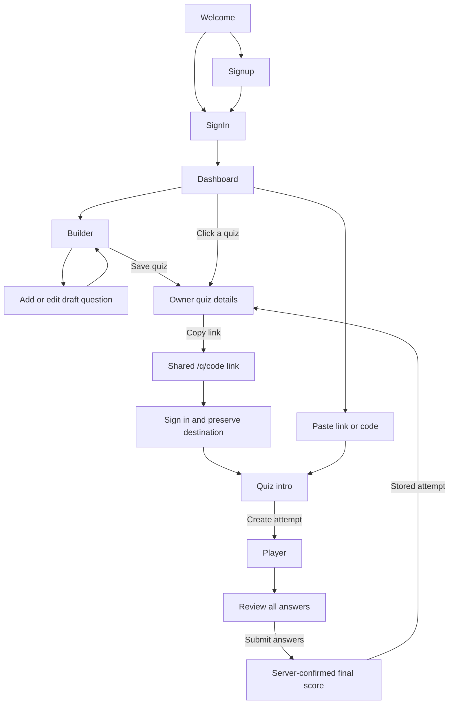

# Quizly frontend: current implementation

The frontend now covers the complete **self-paced, signed-in quiz experience**: welcome, account creation/sign-in, an owner dashboard, quiz drafting, sharing, taking a quiz, reviewing answers, final scores, and owner-visible participant results.

The sibling backend now implements the account, sharing, detail, attempt, grading, and owner-results API described in [backend-contract.md](backend-contract.md). Normal mode uses real requests and never silently substitutes sample data. See the [backend setup guide](../../quizzo_backend/README.md) and [verification status](../../quizzo_backend/documentation/verification.md).

The original source inspection is preserved in [initial-frontend-audit.md](initial-frontend-audit.md).

## Run it

From `QuizApp/quizzo_frontend`:

```powershell
npm.cmd run dev
```

Normal mode sends relative `/api` requests. Vite proxies these to `VITE_BACKEND_URL`, defaulting to `http://127.0.0.1:4444`. Production builds can be served directly by the backend on the same origin. For a separately hosted API, set `VITE_API_URL` at build time and allow the frontend's origin in backend CORS. See [.env.example](../.env.example).

For the complete local UI preview:

```powershell
npm.cmd run dev:demo
```

The demo script uses Vite's `demo` mode and [.env.demo](../.env.demo) to set `VITE_DEMO_MODE=true`. Sign in with **maya@example.com**; no password is needed in this explicitly simulated mode. It includes two sample quizzes and three sample participant results. You can create a second preview account, sign in, take a quiz, and then return to Maya's account to see the new result.

Preview data lives in this browser's localStorage. Its links work only within the same browser storage/origin. They cannot carry quizzes to another device. Do not use preview results as real assessment records.

The standard production build does not enable demo mode. Do not deploy a demo-mode build as a real authenticated service.

## User journeys

### Welcome and accounts

The welcome page exposes Sign in and Create account directly in the navigation, plus Create your first quiz and Join a quiz actions. The design uses a dark background, lime accents, calm typography, and a static example question card.

Signup collects a display name, email, and password. In normal mode the password must have at least eight characters. It shows request loading/errors and routes a successful registration to sign-in with a confirmation. The backend persists the name, hashes the password, and returns safe profiles. The email fallback remains useful for older accounts.

Sign-in validates the token response and awaits `/api/auth/me` before navigating. This fixes the previous redirect race where the guard saw an empty user immediately after login. When a signed-out participant opens a shared link, that destination is carried through both sign-in and signup.

A restored token is checked on app startup. A network failure shows a retry option instead of discarding the token. A confirmed `401` or `403` clears an invalid session. Sign out is available from the header.

### Owner workspace

The dashboard contains Create a quiz / Continue your draft, Join a quiz, creation/attempt totals where available, a search field, and clickable My quizzes cards.

Each card opens an owner detail screen with quiz information, a copyable share link, participant/attempt/average-score statistics, a searchable results table, recent/highest-score sorting, and refresh. The table shows each participant's name, score, percentage, and completion date. Retakes appear as separate completed attempts.

An expandable owner-only question list shows the questions and correct answers. Participant endpoints must never return this answer key.

Owner detail and participant results now use their dedicated endpoints directly. A missing or forbidden quiz shows an error/retry state.

### Drafting a quiz

The builder includes title, optional description, question previews, edit/delete actions, reset, and Save quiz & get link. Drafts are scoped to the signed-in account and to live/demo mode, and persist in localStorage across refreshes.

The question editor supports 2–10 choices, an explicitly selected correct answer, case-insensitive duplicate validation, and editing an existing draft question. Removing a choice adjusts or clears the correct-answer selection.

Limits match the active backend: 150 title characters, 2,000 description/question characters, 500 characters per choice, and 1–200 questions. The title and every question are checked again before submission.

Saving sends only the fields the server owns as user input: title, description, question text/options/correct index. Draft IDs and ownership are not submitted. The draft resets only after the server confirms a saved quiz ID. An uncertain timeout retains the draft and tells the user to check their saved list before retrying.

Saving routes to the quiz detail screen. The backend returns `shareId`; that screen creates an ordinary web link and lets the owner copy or open it.

### Taking a quiz

All participant routes require sign-in. Join a quiz accepts a code or a URL ending in `/q/:shareId`.

The quiz intro shows the title, description, creator, question count, and signed-in participant name. It explains that the creator will see that name and final score. Starting creates a separate attempt; it does not modify the shared quiz.

The player shows one question at a time, accessible radio choices, next/previous navigation, question-jump controls, and answered progress. Answers are stored locally under the current user and attempt ID so a refresh of the same attempt can restore them. The UI warns if browser storage is unavailable.

A review screen lets the participant revisit any choice. All questions must be answered before submission. Submission sends question IDs and selected indexes, never a client-calculated score. Repeated submissions use the same attempt-specific idempotency key.

The final screen uses the server-confirmed score and indicates that the result was recorded. Opening a submitted attempt redirects to its result. Opening the result URL of an unfinished attempt returns to the player. Take it again creates another attempt through the intro page.

## Routes

| URL | Screen | Access |
| --- | --- | --- |
| `/` | Welcome | Public |
| `/auth` | Redirect to sign-in | Public |
| `/auth/signup` | Signup | Public; redirects signed-in users |
| `/auth/signin` | Sign-in | Public; redirects signed-in users |
| `/crud` | Dashboard / My quizzes | Signed in |
| `/crud/createquiz` | Quiz builder | Signed in |
| `/crud/createquiz/create-question` | New draft question | Signed in |
| `/crud/createquiz/questions/:questionId` | Edit draft question | Signed in |
| `/crud/joinquiz` | Enter link/code | Signed in |
| `/crud/quizzes/:quizId` | Owner detail and participant results | Signed in; server enforces ownership |
| `/q/:shareId` | Participant quiz intro | Signed in |
| `/attempts/:attemptId` | Player and answer review | Signed in; server enforces participant ownership |
| `/attempts/:attemptId/result` | Final score | Signed in; server enforces participant ownership |
| Any other path | Not-found screen | Public |



## Architecture

```text
main.jsx / StrictMode
  App
    AuthProvider
      Workspace
        QuizDraftProvider (keyed by mode + user)
          BrowserRouter / AllRoutes
            AppLayout (header, navigation, footer, preview notice)
              public screens
              ProtectedRoute
                owner and participant screens
```

The frontend remains React 19, React Router 7, Vite 7, Axios, and plain CSS. No new runtime dependency was added.

The earlier app-wide socket connection and automatic `join-quiz` emission were removed. Self-paced attempts use HTTP. Socket.IO can be added later for optional owner-dashboard notifications; a persistent connection is not required to open the quiz or submit an answer.

### File responsibilities

| Files | Responsibility |
| --- | --- |
| [App.jsx](../src/App.jsx), [all_routes.jsx](../src/logic/all_routes.jsx) | Providers, identity-scoped draft lifetime, and route tree |
| [ProtectedRoute.jsx](../src/logic/ProtectedRoute.jsx) | Loading, restore failures, sign-in redirect, and destination preservation |
| [AppLayout.jsx](../src/components/AppLayout.jsx) | Header, account menu, sign-out, footer, route scroll reset |
| [Icons.jsx](../src/components/Icons.jsx) | Small code-native SVG icon set |
| [Feedback.jsx](../src/components/Feedback.jsx) | Loading, error/retry, empty, and notice components |
| [SharePanel.jsx](../src/components/SharePanel.jsx) | Share URL display, clipboard copy/fallback, and quiz code |
| [AuthContext.jsx](../src/context/AuthContext.jsx), [auth-context.js](../src/context/auth-context.js) | Token/session lifecycle and auth hook |
| [QuizDraftContext.jsx](../src/context/QuizDraftContext.jsx), [quiz-draft-context.js](../src/context/quiz-draft-context.js) | Draft persistence and add/edit/delete/reset operations |
| [useResource.js](../src/hooks/useResource.js) | Loading/error/data/retry state; ignores stale responses after unmount |
| [Welcome.jsx](../src/pages/Welcome.jsx), [AuthPage.jsx](<../src/pages/auth pages/AuthPage.jsx>), [SignIn.jsx](<../src/pages/auth pages/SignIn.jsx>), [SignUp.jsx](<../src/pages/auth pages/SignUp.jsx>) | Public entry and account screens |
| [LandingPage.jsx](../src/pages/quiz_crud_pages/LandingPage.jsx), [MyQuizzes.jsx](../src/pages/quiz_crud_pages/MyQuizzes.jsx) | Dashboard fetching, totals, search, and quiz cards |
| [CreateQuiz.jsx](../src/pages/quiz_crud_pages/CreateQuiz.jsx), [CreateQ.jsx](../src/pages/quiz_crud_pages/CreateQ.jsx) | Builder and question editor |
| [JoinQuiz.jsx](../src/pages/quiz_crud_pages/JoinQuiz.jsx), [QuizDetail.jsx](../src/pages/quiz_crud_pages/QuizDetail.jsx) | Join form and owner results |
| [QuizIntro.jsx](../src/pages/participation/QuizIntro.jsx), [QuizPlayer.jsx](../src/pages/participation/QuizPlayer.jsx), [QuizResult.jsx](../src/pages/participation/QuizResult.jsx) | Participant experience |
| [Auth_Handler.jsx](../src/api/Auth_Handler.jsx), [Quiz_Handler.js](../src/api/Quiz_Handler.js), [axios.jsx](../src/api/axios.jsx) | API adapter and real HTTP client |
| [demoStore.js](../src/api/demoStore.js), [demoApi.js](../src/api/demoApi.js) | Explicit local preview adapter with sample data and simulated scoring |
| [quiz.js](../src/lib/quiz.js), [storage.js](../src/lib/storage.js) | Input/payload validation, link parsing, names/dates, safe storage |
| [config.js](../config.js), [vite.config.js](../vite.config.js) | Optional public API origin, Vite API proxy, and explicit demo-mode flag |
| [ids.js](../src/lib/ids.js) | Cryptographic draft/request IDs, including a local-network HTTP fallback |
| [index.css](../src/index.css) | Current responsive visual design and shared component styles |

The old `CreateQuiz.css`, `MyQuizzes.css`, `App.css`, `CursorFX.jsx`, `src/lib/auth.jsx`, and empty `logic/routes.jsx` remain in the repository but are not imported into the active UI. `src/config` re-exports the root configuration for compatibility.

Typography uses DM Sans and Manrope with system font fallbacks. Layouts adapt down to 320 px. Form labels, keyboard focus rings, a skip link, alert/status feedback, semantic tables, native radio controls, and reduced-motion rules are included. A visual/accessibility audit is still required because browser automation was blocked during this task.

### Data ownership

| Data | Where it belongs |
| --- | --- |
| Profile and authoritative identity | Backend User document |
| JWT | Browser localStorage; verified by backend |
| Unpublished draft | Account-scoped browser localStorage |
| Published questions and answer key | Backend Quiz/version document |
| Shared link | Public frontend URL containing an opaque server-issued share ID |
| Current selections before submission | Browser storage scoped by user and attempt |
| Final score and completed attempt | Backend Attempt document |
| Sample preview accounts, quizzes, and grades | Separate local preview store only |

Live tokens keep the existing `token` key. Demo tokens use `quizly:demo:token`. Drafts and selections include the environment and user ID in their keys, so changing users cannot display another account's draft or answers.

## Backend integration

All API routes and response fields are detailed in [backend-contract.md](backend-contract.md). The server stores profile names, hashes passwords, issues expiring tokens and share IDs, enforces owner/participant access, omits answer keys from participant payloads, and grades submissions against private attempt snapshots.

The previous summary-only detail fallback and server-update notices have been removed. API error messages now retain the server's specific sign-in explanation instead of treating bad credentials as an expired session. Publishing remains a create operation; an uncertain timeout can require checking My quizzes before retrying.

The [backend integration suite](../../quizzo_backend/tests/integration/workflow.test.js) loads the actual frontend API helpers through Vite and exercises them over HTTP with isolated MongoDB records. Its execution status is recorded in the [verification report](../../quizzo_backend/documentation/verification.md).

## Checks and remaining verification

`npm.cmd test` runs Node's built-in test runner without adding a test dependency. Tests cover link parsing, safe auth destinations, payload whitelisting, question validation, independent attempts, hidden answer keys, owner/participant access in the preview adapter, idempotent submissions, and owner-visible results.

`npm.cmd run lint` checks the source, and `npm.cmd run build` checks production bundling. Preview-adapter tests do not certify backend security or real database persistence.

The frontend tests, ESLint, and production build pass. In this restricted Windows environment, the build uses `npm.cmd run build -- --configLoader native` because the default esbuild config loader cannot read parent directories.

Computer Use could not complete the browser walkthrough because it could not verify whether the existing Chrome URL was allowed. The UI was not visually verified in that session. A manual browser acceptance run is still needed for welcome/account screens, mobile layouts, editing, sharing, a second participant account, final scores, and owner results. Normal mode requires a running backend/database; demo mode remains an explicitly local UI preview.
